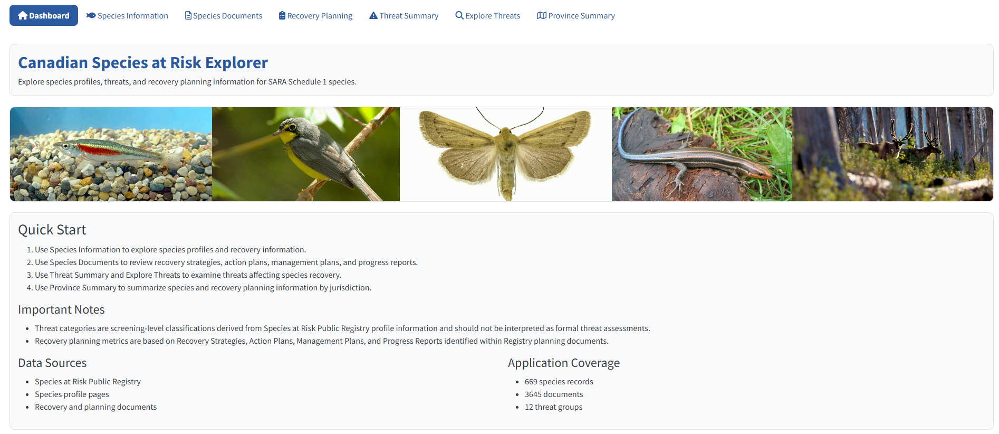

# Canadian Species at Risk Explorer

An interactive Shiny application for exploring Canadian species listed under Schedule 1 of the *Species at Risk Act* (SARA).

The application brings together species profiles, threat information, recovery-planning documents, management-planning information, compliance metrics, and species imagery in a single interface. The tool is designed to support exploration and summarization of publicly available information from the Species at Risk Public Registry across multiple taxonomic groups.

<p align="center">
  
</p>
<p align="center">
  <em>Figure 1. Dashboard page of the Canadian Species at Risk Explorer.</em>
</p>

## Features

- Browse Schedule 1 species listed under SARA.
- Explore species profile information and identified threats.
- Filter results by taxonomic group, SARA status, and geographic range.
- Access Recovery Strategies, Action Plans, Management Plans, Progress Reports, and COSEWIC Assessments.
- Review recovery planning compliance metrics, including:
  - Recovery Strategy publication timelines.
  - Progress Report publication timelines.
  - Legislative due dates and compliance status.
- Summarize recovery planning coverage and threat occurrence across species and jurisdictions.

### Dashboard

Provides a high-level overview of the application and its underlying data sources.

- Application overview
- Data source information
- Coverage statistics
  - Species records
  - Species documents
  - Threat groups
- Important notes

### Species Information

Explore detailed species profile information by species, designatable unit (DU), SARA status, and geographic range.

**Includes:**

- Species description
- Population information
- Habitat information
- Biology information
- Species-specific threat summaries
- Threat category listings

**Filters:**

- Taxonomic Group
- SARA Status
- Province/Territory
- Species
- DU

### Species Documents

Access recovery planning and assessment documents associated with each DU.

**Includes:**

- Recovery Strategies
- Action Plans
- Management Plans
- COSEWIC Assessments and Status Reports
- Direct links to source documents
- Recovery planning compliance summaries
- Legislative due dates and reporting status
- Direct links to source documents

**Filters:**

- Taxonomic Group
- SARA Status
- Province/Territory
- Species
- DU

### Recovery Planning Compliance

The application calculates legislative recovery-planning metrics using document publication dates from the Species at Risk Public Registry.

Metrics currently include:

- Recovery Strategy tracking
- Action Plan tracking
- Management Plan tracking
- Progress Report status tracking
- Recovery planning coverage summaries

For species listed as Special Concern, Management Plans are tracked where available. Recovery Strategy and Progress Report requirements may not apply.

These metrics are intended as screening-level indicators and should not be interpreted as formal assessments of regulatory compliance.

### Recovery Planning

Summarizes recovery planning progress across species and DUs.

**Includes:**

- Recovery planning coverage by DU
- Recovery Strategy tracking
- Action Plan tracking
- Management Plan tracking
- Most recent recovery planning document date
- Years since publication of the most recent recovery planning document
- Visual highlighting of older planning documents

**Filters:**

- Taxonomic Group
- SARA Status
- Province/Territory

### Threat Summary

- Provides summary information on threats identified within Species at Risk Public Registry profile information.

**Includes:**

- DUs with the greatest number of identified threat categories
- Most common threat categories across species
- Threat summaries by taxonomic group and geographic range

**Filters:**

- Taxonomic Group
- Province/Territory

### Explore Threats

Allows users to identify species affected by specific threat categories.

**Filter by:**

- Taxonomic Group
- Threat Group
- SARA Status
- Province/Territory

**Includes:**

- Interactive species results table
- Threat prevalence summaries
- Species record counts and proportions associated with selected threats
- Direct navigation to Species Information records

### Province Summary

Provides an overview of species-at-risk information within a selected province, territory, or region.

**Includes:**

- Species record counts
- SARA status summaries
- Most common threat categories
- Provincial species overview metrics

**Filters:**

- Taxonomic Group
- Province/Territory

### Data Sources

Data are derived from:

- Species at Risk Public Registry
- Species profile pages
- Recovery Strategies
- Action Plans
- Management Plans
- Progress Reports
- COSEWIC Assessment and Status Reports

# Threat Group Consolidation

Threat categories identified within species profile information are consolidated into broader threat groups loosely following the IUCN Threat Classification Scheme.

- Residential and Commercial Development
- Agriculture and Aquaculture
- Energy Production and Gas
- Transportation and Service Corridors
- Biological Resource Use
- Human Intrusions and Disturbance
- Natural Systems Modification
- Invasive Species and other Problematic Species, Genes, and Diseases
- Pollution
- Geological Events
- Climate Change
- Other Limiting Factors

Threat categories are intended as **screening-level classifications** and should not be interpreted as formal threat assessments.

## Running the App

Download the Tool as a Zip file to your local machine. Extract the files. Open the run_app.R script. Install the required packages if needed and run:

```r
library(shiny)
library(dplyr)
library(DT)
library(bslib)

runApp("app/app.R")
```

## Updating Application Data

The application is built from static data snapshots derived from the Species at Risk Public Registry.

To refresh all datasets, run:

```r
source("refresh_data.R")
```

## Project Structure

```text
DFO-SAR-Intelligence-Tool/
│
├── app/
│   ├── app.R
│   ├── refresh_data.R
|   |
|   ├── data/
│   |   ├── progress_report_compliance.rds
│   |   ├── recovery_compliance.rds
│   |   ├── species_master.rds
│   |   ├── species_profiles.rds
│   |   ├── species_threats.rds
│   |   └── species_documents.rds
|   |
│   └── www/
|       └── images/
|           ├── acadian_flycatcher.jpg
|           ├── acuteleaf_small_limestone_moss.jpg
|           ├── ...
|           └── yukon_wild_buckwheat.jpg
│
├── data_processed/
│   ├── all_progress_report_compliance.csv
│   ├── all_recovery_compliance.csv
│   ├── all_species_document_summary.csv
│   ├── all_species_documents.csv
│   ├── all_species_full.csv
│   ├── all_species_master.csv
│   ├── all_species_master_raw.csv
│   ├── all_species_profiles.csv
│   ├── all_species_threats.csv
│   ├── all_species_threats_summary.csv
│   └── all_threat_category_frequency.csv
|
├── scripts/
|   ├── 00_setup.R
|   ├── 01_build_species_master.R
|   ├── 02_clean_species_master.R
|   ├── 03_build_species_profiles.R
|   ├── 04_build_threat_dictionary.R
|   ├── 05_build_document_inventory.R
|   ├── 06_exploratory_analysis.R
|   ├── 07_build_recovery_compliance.R
|   ├── 08_download_images.R
|   ├── 09_prepare_shiny_data.R
|   └── run_full_refresh.R
|
├── .gitignore
├── DFO-SAR-Intelligence-Tool.Rproj
├── README.md
├── LICENSE
└── run_app.R

```

## Known Limitations

- Threat categories are screening-level classifications derived from Species at Risk Public Registry profile information.
- Threat categories should not be interpreted as formal threat assessments.
- Recovery planning metrics are derived from identified Registry documents and are intended for exploratory and summary purposes.
- Species imagery availability varies among species.

## Acknowledgements

This application was developed using information obtained from the Species at Risk Public Registry and associated recovery planning resources.

## License

This project is licensed under the **MIT License**. See `LICENSE` for complete licensing terms.

Copyright (c) 2026 His Majesty the King in Right of Canada, as represented by the Minister of Fisheries and Oceans.

## Contact

For questions, suggestions, or data updates, please contact:

**Karl Lamothe**
Aquatic Science Biologist
Fisheries and Oceans Canada

karl.lamothe@dfo-mpo.gc.ca