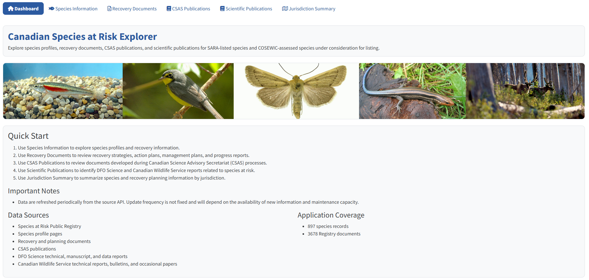

# Canadian Species at Risk Explorer 

### Version 3.4

Canadian Species at Risk Explorer provides an interactive interface for exploring species profiles, registry documents, and scientific publications associated with species at risk in Canada.

Scientific publications are linked to species records using species names, scientific names, historical aliases, and related taxonomic references. Publications can be explored alongside recovery planning documents and other Species at Risk Public Registry resources.

<p align="center">
  
</p>
<p align="center">
  <em>Figure 1. Dashboard page of the Canadian Species at Risk Explorer.</em>
</p>

## Features

- Browse SARA-listed species and COSEWIC-assessed species included in the listing process.
- Explore species profiles, recovery planning information, and registry documents.
- Filter records by Listing Status, Taxonomic Group, SARA Status, and geographic range.
- Access Recovery Strategies, Action Plans, Management Plans, Progress Reports, and COSEWIC Assessments.
- Browse CSAS publications associated with species records.
- Browse DFO Science and Canadian Wildlife Service scientific publications associated with species records.
- Access direct links to publication pages and PDFs where available.
- Explore species-publication relationships derived from scientific-name and alias matching.

## Listing Status Categories

The application classifies records into the following categories:

| Listing Status | Description |
|---------------|-------------|
| SARA Listed | Species listed under Schedule 1 of SARA |
| Under Consideration | Species currently undergoing the listing process |
| COSEWIC Assessed | Species assessed by COSEWIC but not currently listed |
| Referred Back | Listing decision referred back for further consideration |
| Not Listed | Governor in Council decision not to list |

### Dashboard

Provides a high-level overview of the application and its underlying data sources.

- Application overview
- Data source information
- Coverage statistics
  - Species records
  - Species documents
  - CSAS Publications
  - Scientific Publications
  - Threat groups
- Important notes

### Species Information

Explore detailed species profile information by species, designatable unit (DU), SARA status, and geographic range.

**Includes:**

- Species description
- Population information
- Habitat information
- Biology information
- Threat information

**Filters:**

- Taxonomic Group
- Listing Status
- SARA Status
- Province/Territory
- Species
- DU

### Species Documents

Access recovery planning and assessment documents associated with each DU.

**Includes:**

- Recovery Strategies
- Action Plans
- Management Plans
- COSEWIC Assessments and Status Reports
- Direct links to source documents

**Filters:**

- Taxonomic Group
- Listing Status
- SARA Status
- Province/Territory
- Species
- DU

### CSAS Publications

Provides access to Canadian Science Advisory Secretariat (CSAS) science publications associated with species records.

CSAS publications are linked at the species level using scientific-name matching and may be relevant to multiple Designatable Units (DUs).

**Includes:**

- Research Documents
- Science Advisory Reports
- Science Responses
- Proceedings
- Direct links to publication PDFs where available
- Publication year and document type
- Species-level publication summaries

**Filters:**

- Taxonomic Group
- Listing Status
- SARA Status
- Province/Territory
- Species
- DU

### Scientific Publications

Provides access to DFO Science and Canadian Wildlife Service publications associated with species records.

Scientific publications are linked using scientific names, common names, historical names, and species aliases. Publications may be relevant to multiple Designatable Units (DUs).

**Includes:**

- DFO Technical Reports
- DFO Manuscript Reports
- DFO Data Reports
- Canadian Wildlife Service Technical Reports
- Wildlife Management Bulletins
- Occasional Papers
- Direct links to source publications
- Publication source attribution
- Publication series information

**Filters:**

- Taxonomic Group
- Listing Status
- SARA Status
- Province/Territory
- Species
- DU

### Jurisdictional Summary

Provides an overview of species-at-risk information within a selected province, territory, or region.

**Includes:**

- Species record counts
- SARA status summaries
- Provincial species overview metrics

**Filters:**

- Taxonomic Group
- Province/Territory

### Data Sources

Data are derived from:

- Species at Risk Public Registry
- Species profile pages
- Recovery Strategies
- Action Plans
- Management Plans
- Progress Reports
- COSEWIC Assessment and Status Reports
- Canadian Science Advisory Secretariat (CSAS)
- CSAS Publications Archive
- DFO Science Publications Repository
- Canadian Wildlife Service Publication Series
  - Technical Report Series
  - Wildlife Management Bulletin
  - Occasional Papers

## Running the App

Download the Tool as a Zip file to your local machine. Extract the files. Open the run_app.R script. Install the required packages if needed and run:

```r
library(shiny)
library(dplyr)
library(DT)
library(bslib)

runApp("app/app.R")
```

## Project Structure

```text
DFO-SAR-Intelligence-Tool/
│
├── app/
│   ├── app.R
|   |
|   ├── data/
│   |   ├── all_science_publications.rds
│   |   ├── all_species_links.rds
│   |   ├── csas_publications.rds
│   |   ├── csas_species_links.rds
│   |   ├── species_master.rds
│   |   ├── species_profiles.rds
│   |   └── species_documents.rds
|   |
│   └── www/
|       └── images/
|           ├── acadian_flycatcher.jpg
|           ├── acuteleaf_small_limestone_moss.jpg
|           ├── ...
|           └── yukon_wild_buckwheat.jpg
│
├── data_processed/
│   ├── all_science_publications.csv
│   ├── all_science_publications.rds
│   ├── all_species_documents.csv
│   ├── all_species_links.rds
│   ├── all_species_master.rds
│   ├── all_species_profiles.csv
│   ├── all_species_raw.rds
│   ├── csas_publications.csv
│   └── csas_species_links.csv
|
├── scripts/
|   ├── 00_setup.R
|   ├── 01_build_species_master.R
|   ├── 02_clean_species_master.R
|   ├── 03_build_CSAS_publications.R
|   ├── 04_build_scientific_publications.R
|   ├── 05_build_species_profiles.R
|   ├── 06_build_document_inventory.R
|   ├── 07_download_images.R
|   ├── 08_prepare_shiny_data.R
|   └── run_full_refresh.R
|
├── .gitignore
├── DFO-SAR-Intelligence-Tool.Rproj
├── README.md
├── LICENSE
├── refresh_data.R
└── run_app.R

```
## Important Note

- The application includes instructions for refreshing the source data. Access to the source API is required and credentials are not distributed with this repository. Configure the required environment variables prior to running the refresh workflow.
- Data are refreshed periodically from the source API. Update frequency is not fixed and will depend on the availability of new information and maintenance capacity. Please contact Karl Lamothe if you wish to have the data updated.

## Known Limitations

- Species imagery availability varies among species.
- CSAS publication matching is performed at the species level using scientific names and may not distinguish between Designatable Units.
- Scientific publication matching is based on common names, scientific names, historical aliases, and related species nomenclature.
- Publication-species relationships should be considered screening-level linkages and may require expert review for specific applications.
- Publications linked to broad taxonomic aliases may be relevant to multiple populations or Designatable Units.
- Not all publication repositories provide direct PDF access.

## Acknowledgements

This application was developed using information obtained from the Species at Risk Public Registry, Canadian Science Advisory Secretariat publications, DFO Science publication repositories, Canadian Wildlife Service publication series, and associated recovery planning resources.

## License

This project is licensed under the **MIT License**. See `LICENSE` for complete licensing terms.

Copyright (c) 2026 His Majesty the King in Right of Canada, as represented by the Minister of Fisheries and Oceans.

## Contact

For questions, suggestions, or data updates, please contact:

**Karl Lamothe**
Aquatic Science Biologist
Fisheries and Oceans Canada

Email: karl.lamothe@dfo-mpo.gc.ca